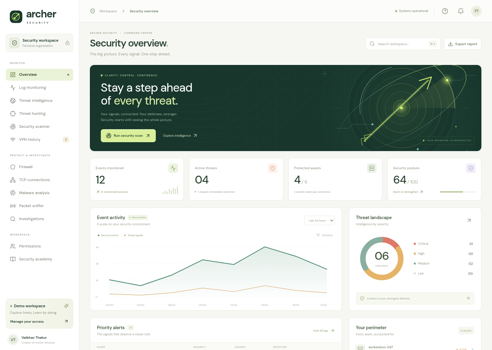

# Archer Security

**A cybersecurity operations workspace made by Vaibhav Thakur.**

Archer Security brings log monitoring, threat investigation, network analysis,
response exercises, and cybersecurity learning into one dashboard. Its ivory,
forest-green, and lime interface includes original radar-and-arrow artwork,
responsive layouts, and a five-question security academy.



## What you can do

| Area                       | Capabilities                                                                                                                              |
| -------------------------- | ----------------------------------------------------------------------------------------------------------------------------------------- |
| Security overview          | Review security posture, priority alerts, assets, threat severity, and a sample event timeline. Export a workspace report.                |
| Log monitoring             | Search, filter, inspect, and export seeded events and response-action logs.                                                               |
| Threat intelligence        | Explore sample IP, domain, and file-hash indicators with confidence, tactics, and context.                                                |
| Threat hunting             | Search workspace logs and intelligence with plain-text queries. All query terms must match.                                               |
| Security scanner           | Assess the demo asset inventory and review prioritized findings and recommendations.                                                      |
| VPN history                | Import CSV history or analyze the sample sessions for impossible travel, repeated authentication failures, and demo intelligence matches. |
| Firewall                   | Create and remove validated demo allow/deny rules for IP addresses, CIDR ranges, ports, and protocols.                                    |
| Response and investigation | Block or isolate a demo asset, open an investigation, and review related evidence and the activity trail.                                 |
| TCP connections            | Inspect flow states and analyze supplied JSON metadata for aged half-open connections and repeated incomplete handshakes.                 |
| Malware analysis           | Analyze file bytes for SHA-256, entropy, file signatures, URLs, suspicious strings, and misleading double extensions.                     |
| Packet sniffer             | Replay synthetic packets with start, pause, protocol filters, and search.                                                                 |
| Permissions                | Explore Viewer, Analyst, and Administrator roles with API-enforced permissions.                                                           |
| Security academy           | Answer exactly five cybersecurity questions, receive a server-graded score, and review explanations.                                      |

## Demo behavior and analysis boundaries

The workspace starts with **synthetic network telemetry, sample threat indicators,
and a demo asset inventory**. The scanner assesses that inventory; it does not
scan external hosts. The sniffer replays sample packets; it does not capture
network traffic. Firewall, block, and isolate actions update the local demo state
and audit trail; they do not change operating-system or network controls.

CSV VPN analysis, TCP metadata analysis, file hashing and static inspection,
threat hunts, quiz grading, and permission checks run on the local server. These tools
analyze the input you provide. VPN alerts and suspicious file patterns are leads
for review, not proof of compromise. No live geolocation, commercial intelligence
feed, endpoint agent, antivirus engine, or execution sandbox is connected.

Demo roles can be selected freely to explore the interface. This is **not
production authentication** or a multi-user security boundary. Use a controlled
development environment; deploying a real security service requires identity
verification, trusted integrations, and operational controls.

## Run the project

Requires **Node.js 22 or newer** and npm.

```sh
cd /workspace/Cybersecurity_2
npm ci --cache /workspace/.cache/npm
npm run dev
```

The cloud command uses a writable npm cache under `/workspace`. On another
machine, use your clone's directory and run `npm ci` with its normal cache.

`npm run dev` starts the Express API on port **3001** and Vite on port **5173**.
Vite forwards `/api` requests to the API. The interface opens with an Analyst
demo session; use **Permissions** to try another role.

For a production build served by Express:

```sh
npm run build
npm start
```

Express serves the built interface and API on port **3001**, bound to
`127.0.0.1` by default. No API keys, database service, or external threat-feed
credentials are needed for this project.

| Command            | Purpose                                                                        |
| ------------------ | ------------------------------------------------------------------------------ |
| `npm run dev`      | Run the API watcher and Vite together.                                         |
| `npm run dev:api`  | Run only the API watcher.                                                      |
| `npm run dev:web`  | Run only Vite; the API must also be running.                                   |
| `npm run build`    | Build the web interface into `dist/`.                                          |
| `npm start`        | Run Express and serve the built interface when `dist/` exists.                 |
| `npm test`         | Run the Node.js backend and analysis tests.                                    |
| `npm run test:e2e` | Build the interface and run five Playwright browser tests across all 13 views. |

### Browser tests

The end-to-end suite starts its own server on port **3102** with isolated,
temporary demo state. It covers navigation through all 13 views, analysis tools,
role restrictions, response actions, and the complete five-question quiz without
changing your normal workspace data.

The Playwright configuration uses `/usr/bin/chromium` when available. To use a
different Chromium executable, set `PLAYWRIGHT_CHROMIUM_PATH` to its full path.
Otherwise, install Playwright's browser and required system dependencies first:

```sh
npx playwright install chromium --with-deps
npm run test:e2e
```

Browser installation is separate from `npm ci` and may require system package
installation privileges.

### Runtime configuration

| Variable           | Default            | Purpose                                                                                                   |
| ------------------ | ------------------ | --------------------------------------------------------------------------------------------------------- |
| `HOST`             | `127.0.0.1`        | API/production server bind address. Use `0.0.0.0` only when access from a controlled network is intended. |
| `PORT`             | `3001`             | API/production server port. If changed during development, update the Vite API proxy accordingly.         |
| `ARCHER_DATA_FILE` | `.data/state.json` | Path for persisted demo state.                                                                            |

The default data file stores demo assets, logs, rules, scans, investigations, and
the activity trail. It is created when an operation saves state and is ignored
by Git. File-analysis uploads are never saved or executed. Only their name,
size, and an analysis activity entry are retained. Session tokens stay in server
memory, expire after 12 hours, and must be recreated after a server restart.

## Permissions

Permissions are checked by the API for each protected operation, as well as
represented in the interface.

| Capability                            | Viewer | Analyst | Administrator |
| ------------------------------------- | :----: | :-----: | :-----------: |
| View workspace data and packet replay |  Yes   |   Yes   |      Yes      |
| Take the five-question quiz           |  Yes   |   Yes   |      Yes      |
| Run inventory scans                   |   —    |   Yes   |      Yes      |
| Hunt through logs and intelligence    |   —    |   Yes   |      Yes      |
| Analyze VPN, TCP, and file inputs     |   —    |   Yes   |      Yes      |
| Open investigations                   |   —    |   Yes   |      Yes      |
| Create or remove firewall rules       |   —    |    —    |      Yes      |
| Block or isolate demo assets          |   —    |    —    |      Yes      |

## Analyze your own input

### VPN history CSV

Required columns are `user`, `ip`, and `timestamp`. Optional columns are
`country`, `city`, `status`, `device`, `latitude`, and `longitude`. Use ISO 8601
timestamps with a time-zone offset. `status` defaults to `success`; allowed
values are `success`, `failed`, and `mfa_failed`.

```csv
user,ip,timestamp,country,city,status,device,latitude,longitude
analyst,192.0.2.10,2026-10-23T09:00:00Z,India,Mumbai,success,Laptop,19.076,72.8777
analyst,203.0.113.10,2026-10-23T09:18:00Z,Germany,Berlin,success,Laptop,52.52,13.405
```

The parser accepts up to **500 KB** of CSV text and **1,000 records**. Travel
analysis needs latitude and longitude for both sign-ins. It flags consecutive
successful sign-ins more than 500 km apart when the implied speed exceeds
900 km/h. It also reports three or more failed sign-ins for the same user and
source across the supplied history. VPN routing and inaccurate coordinates can
cause false positives.

### TCP connection metadata

Paste an array of flow records in **TCP connections**:

```json
[
  {
    "source": "192.0.2.10",
    "destination": "192.0.2.20",
    "port": 443,
    "state": "SYN_SENT",
    "ageSeconds": 42,
    "bytes": 0
  }
]
```

Up to **1,000 records** are accepted. Source and destination must be valid IP
addresses. Supported states are `ESTABLISHED`, `SYN_SENT`, `SYN_RECEIVED`,
`CLOSED`, `TIME_WAIT`, and `FIN_WAIT`. The detector marks pending SYN states
aged **15 seconds or more** as half-open timeouts and highlights sources with
three or more such flows. This metadata alone cannot establish a SYN-flood
attack.

### Static file analysis

Choose a file between **1 byte and 2 MiB**, or use the harmless sample in the
Malware analysis view. The server calculates a SHA-256 hash, measures entropy,
identifies common file signatures, and inspects strings and filename patterns.
Embedded URLs are extracted without contacting them. The file is never executed
or retained, and a result with no obvious indicators does not establish safety.

## Implementation

- **Frontend:** React 19, Vite 6, locally bundled DM Sans typography, Lucide icons,
  responsive CSS, and original SVG wallpaper and branding.
- **Backend:** Express 5, Node.js crypto and filesystem APIs, bearer demo
  sessions, role checks, input validation, and atomic JSON state persistence.
- **Tests:** Node's built-in test runner covers session expiry, permissions,
  firewall validation and persistence, failed-write rollback, hunting, scanning,
  VPN and TCP detectors, file inspection, quiz grading, and invalid requests.
  Five Playwright tests exercise all 13 views and their main workflows in a
  browser using isolated demo state.

```text
public/                  Brand mark and radar wallpaper
scripts/dev.mjs          Combined development process launcher
scripts/e2e-server.mjs   Isolated browser-test server
server/
  app.js                 API, demo sessions, permissions, persistence
  analysis.js            VPN, TCP, CSV, and static-file analysis
  data.js                Demo telemetry and quiz questions
  app.test.js            Backend and analysis tests
  index.js               Server entry point
src/
  App.jsx                Workspace shell and overview
  components/            Security and analysis views
  styles.css             Shared interface styling
tests/e2e/               Playwright workflow tests
playwright.config.js     Browser-test configuration
vite.config.js           Web build and development API proxy
```

**Created by Vaibhav Thakur.**
